<!-- Generated by Tools/SpeechReview/generate.py; edit cases.json or introduction.md. -->
# Native-speaker review packet for issue #63

This packet supports [issue #63](https://github.com/vocaro/MathMLLayout/issues/63):
the remaining novel descriptions in English, French, German, Spanish and Italian.
**Every language is awaiting human review.** Generated examples and automated checks do
not count as linguistic approval.

The [wording audit](../SpeechWordingAudit.md#accepted-evidence-and-remaining-human-review-scope)
already accepts matching upstream rules, locale maps and fixtures as evidence. Review the
complete descriptions and joining policies below. Their component accent, symbol, digit,
punctuation, ordinal and positional script names do not need a new blanket translation review.
If a supported component makes a complete description ambiguous, report that interaction.

## How to review

1. Choose your language and state the region or mathematical teaching convention you know.
   Review S, C, D and P cases; French reviewers also review F cases. A partial review is useful:
   record exactly which case IDs you covered.
2. Read the utterance aloud, or listen through a host voice if available. Before consulting the
   image or intended structure, paraphrase what you understood. Then compare the input/image
   and check whether columns, positions, crossouts and expression boundaries are recoverable.
3. Mark each case **accept**, **revise**, **unclear** or **not reviewed**. For a revision, give the
   complete replacement utterance and explain the ambiguity or regional preference. Do not
   silently replace literal author text or infer an arithmetic operation from a spatial label.
4. Submit the response template below to issue #63. Translation review and listening/user
   findings are recorded separately; listening is useful QA, not a gate on sourced vocabulary.

Column numbers are logical coordinates, not digit values: zero is the alignment reference,
negative numbers lie to its left, and numbers increase to the right. A carry annotation's
crossout applies to the associated column digit, even when the annotation sits beside it.
MathML uses the same carry element for carries and borrows; the engine describes both and
does not guess which arithmetic operation was intended. Division frames describe presentation,
not a calculation method or correctness. See the [speech guide](../../doc/speech.md).

## Review checklist

- [ ] **Stacks (S):** one/multiple row introductions and endings sound natural; negative/zero/positive
  column coordinates cannot be mistaken for values; left/center/right/decimal alignment is clear;
  shifts, blank cells, full-width lines and inclusive endpoints are recoverable.
- [ ] **Carries (C):** the combined carry/borrow category is appropriate in the reviewer's region;
  all eight locations are relative to the column digit; every strike direction is distinct;
  combined strikes and child overrides are understandable; the struck digit is not mistaken
  for the annotation. In German, line/strike descriptions remain distinct from a prime reading.
- [ ] **Division (D):** all ten frame descriptions communicate the divisor and result placement;
  full/medium/short right vertical lines remain distinct; zero/one/multiple working rows and
  their ending are clear; operand labels and shared columns do not imply extra arithmetic meaning.
- [ ] **Scope (P):** all four compound-script endings delimit their expressions; nested scripts
  close before the next outer partner; compound/nested root indices are separable from the
  radicand; lower then upper accents remain associated with the intended base.
- [ ] **French joining (F, French only):** assess letter-name conventions and arbitrary author text
  in root and limit phrases, including vowel letters, consonant letters with vowel-initial names,
  accented/capitalized tokens, mute/aspirated h and the sourced disjunctive-word controls.
  Recommend any needed explicit joining or pronunciation policy; ordinary word elision is sourced.
- [ ] Record acceptable regional alternatives and unresolved cases rather than declaring universal approval.

## Response template

Copy this into a response on issue #63. Do not check a whole scope item on the issue until
the reviewed language/case coverage and unresolved findings have been recorded.

```text
Language and region/teaching convention:
Reviewer attribution (name/handle, or agreed anonymous attribution):
Relevant experience (native speaker, math teaching, screen-reader use, etc.):
Packet/library revision:
Case IDs reviewed:

Repeat for each case or explicitly listed group of accepted cases:
  Case ID(s):
  Verdict: accept / revise / unclear / not reviewed
  What I understood from the current reading:
  Complete suggested replacement (if revise):
  Reason, ambiguity, and any regional alternatives:

Still unreviewed or unresolved:

Optional listening/user QA (separate from the wording verdict):
  Platform/OS, application or screen reader, voice and locale, speaking rate:
  Case IDs heard and observed pronunciation/pause/navigation problems:
```

## Maintainer completion checklist

- [ ] Record case-level findings and attribution for each of en/fr/de/es/it; F cases need French review only.
- [ ] Resolve proposed corrections, documenting regional choices and any still-unreviewed coverage.
- [ ] Apply accepted changes to vocabulary/joining policy and independent parsed regression expectations.
- [ ] Re-run the relevant structural, multiscript, wording and bounds tests when code changes.
  Preserve source order, selected-child behavior, coordinate semantics and traversal budgets.
- [ ] Regenerate this snapshot after wording changes, update the audit with actual human evidence,
  and retain any outstanding language/region or voice limitations. No review has occurred merely
  because this checklist or the examples were generated.

## Regenerating the examples

From the repository root on macOS with Xcode and STIX Two Math installed:

```sh
python3 Tools/SpeechReview/generate.py
```

The generator compiles the checked-out Swift library sources, parses
[`cases.json`](../../Tools/SpeechReview/cases.json), and writes this packet, exact locale
[`readings.json`](readings.json), and rendered PNG examples. Edit
[`introduction.md`](../../Tools/SpeechReview/introduction.md) for review instructions or
`cases.json` for example inputs/prompts, then regenerate. Example IDs stay stable so feedback
remains attributable across revisions. The snapshot revision identifies library code, not a
claim that uncommitted vocabulary changes have been reviewed.

## Example snapshot

Readings and images generated from library revision `43a0bb75e86797638377e7059805460883db5693`. They are actual implementation output, not proposed corrections or human approvals. No audio or voice validation is included.

The examples below retain the implementation's exact text, including punctuation, capitalization and literal author tokens. A formula image shows the current MathMLLayout rendering; it is context for the language review, not an independent rendering oracle.

| Group | Cases | Review focus |
| --- | --- | --- |
| [Stacks and logical columns](#stacks) | S01, S02, S03, S04, S05, S06 | Alignment, signed coordinates, row counts and lines. |
| [Carries, borrows and crossouts](#carries) | C01, C02, C03, C04, C05, C06, C07, C08, C09, C10, C11, C12, C13, C14, C15 | Relative locations, strike targets and regional terminology. |
| [Long-division frames and working rows](#division) | D01, D02, D03, D04, D05, D06, D07, D08, D09, D10 | All ten frames and zero/one/multiple working rows. |
| [Compound expression boundaries](#scope) | P01, P02, P03, P04, P05, P06, P07 | Script closures, compound indices and combined accents. |
| [French formula joining](#french) | F01, F02, F03, F04, F05, F06, F07, F08, F09, F10, F11, F12, F13, F14, F15, F16 | Letter pronunciation, arbitrary author text and regional joining. |

## Stacks and logical columns

<a id="stacks"></a>

### S01: One left-aligned row

**Review:** Can the listener distinguish row number, column number and digit value, and hear where the stack ends?

**English (`en`)**

> stack with 1 row alignment left row 1: column 0: one column 1: two end stack

**French (`fr`)**

> opération posée de 1 ligne alignement à gauche ligne 1 : colonne 0: un colonne 1: deux fin de l'opération

**German (`de`)**

> schriftliche Rechnung mit 1 Zeile Ausrichtung links Zeile 1: Spalte 0: eins Spalte 1: zwei Ende der Rechnung

**Spanish (`es`)**

> operación en columna de 1 fila alineación a la izquierda fila 1: columna 0: uno columna 1: dos fin de la operación

**Italian (`it`)**

> operazione in colonna di 1 riga allineamento a sinistra riga 1: colonna 0: uno colonna 1: due fine dell'operazione

<details>
<summary>Reveal intended structure, rendered context and MathML</summary>

One row: digit 1 at column 0, digit 2 at column 1; left alignment.

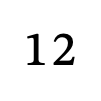

```xml
<math xmlns="http://www.w3.org/1998/Math/MathML"><mstack stackalign="left"><mn>12</mn></mstack></math>
```

</details>

### S02: Nested shifts and finite lines

**Review:** Are negative coordinates and inclusive line endpoints clear, including the repeated endpoint for a one-column line?

**English (`en`)**

> stack with 2 rows alignment left row 1: column minus 2: one column minus 1: two line column minus 3: column minus 2: row 2: column minus 4: three column minus 3: four line column minus 4: column minus 4: end stack

**French (`fr`)**

> opération posée de 2 lignes alignement à gauche ligne 1 : colonne moins 2: un colonne moins 1: deux trait colonne moins 3: colonne moins 2: ligne 2 : colonne moins 4: trois colonne moins 3: quatre trait colonne moins 4: colonne moins 4: fin de l'opération

**German (`de`)**

> schriftliche Rechnung mit 2 Zeilen Ausrichtung links Zeile 1: Spalte minus 2: eins Spalte minus 1: zwei Strich Spalte minus 3: Spalte minus 2: Zeile 2: Spalte minus 4: drei Spalte minus 3: vier Strich Spalte minus 4: Spalte minus 4: Ende der Rechnung

**Spanish (`es`)**

> operación en columna de 2 filas alineación a la izquierda fila 1: columna menos 2: uno columna menos 1: dos línea columna menos 3: columna menos 2: fila 2: columna menos 4: tres columna menos 3: cuatro línea columna menos 4: columna menos 4: fin de la operación

**Italian (`it`)**

> operazione in colonna di 2 righe allineamento a sinistra riga 1: colonna meno 2: uno colonna meno 1: due linea colonna meno 3: colonna meno 2: riga 2: colonna meno 4: tre colonna meno 3: quattro linea colonna meno 4: colonna meno 4: fine dell'operazione

<details>
<summary>Reveal intended structure, rendered context and MathML</summary>

Two rows at columns (-2,-1) then (-4,-3); a line spans -3 through -2, and a one-column line spans -4 through -4. Shifts advance past the first line.

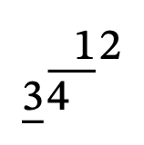

```xml
<math xmlns="http://www.w3.org/1998/Math/MathML"><mstack stackalign="left"><msgroup position="2" shift="1"><mn>12</mn><msline length="2"/><msgroup position="-1"><msrow position="1"><mn>34</mn></msrow></msgroup></msgroup><msline position="4" length="1"/></mstack></math>
```

</details>

### S03: Right alignment and literal punctuation

**Review:** Does the alignment and coordinate phrasing remain natural with literal punctuation, without claiming a decimal/grouping interpretation?

**English (`en`)**

> stack with 1 row alignment right row 1: column minus 7: one column minus 6: space column minus 5: two column minus 4: three column minus 3: four column minus 2: point column minus 1: five end stack

**French (`fr`)**

> opération posée de 1 ligne alignement à droite ligne 1 : colonne moins 7: un colonne moins 6: espace colonne moins 5: deux colonne moins 4: trois colonne moins 3: quatre colonne moins 2: point colonne moins 1: cinq fin de l'opération

**German (`de`)**

> schriftliche Rechnung mit 1 Zeile Ausrichtung rechts Zeile 1: Spalte minus 7: eins Spalte minus 6: Leerzeichen Spalte minus 5: zwei Spalte minus 4: drei Spalte minus 3: vier Spalte minus 2: Punkt Spalte minus 1: fünf Ende der Rechnung

**Spanish (`es`)**

> operación en columna de 1 fila alineación a la derecha fila 1: columna menos 7: uno columna menos 6: espacio columna menos 5: dos columna menos 4: tres columna menos 3: cuatro columna menos 2: punto columna menos 1: cinco fin de la operación

**Italian (`it`)**

> operazione in colonna di 1 riga allineamento a destra riga 1: colonna meno 7: uno colonna meno 6: spazio colonna meno 5: due colonna meno 4: tre colonna meno 3: quattro colonna meno 2: punto colonna meno 1: cinque fine dell'operazione

<details>
<summary>Reveal intended structure, rendered context and MathML</summary>

One row at columns -7 through -1: digits, a grouping space and a literal point. Column 0 is the boundary after the last cell.

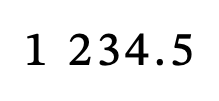

```xml
<math xmlns="http://www.w3.org/1998/Math/MathML"><mstack stackalign="right"><mn>1 234.5</mn></mstack></math>
```

</details>

### S04: Center alignment and a full-width line

**Review:** Can listeners distinguish a full-width line from numbered endpoints and recover the two row boundaries?

**English (`en`)**

> stack with 2 rows alignment center row 1: column minus 1: one column 0: two line across the whole stack row 2: column minus 1: three column 0: four column 1: five end stack

**French (`fr`)**

> opération posée de 2 lignes alignement au centre ligne 1 : colonne moins 1: un colonne 0: deux trait sur toute la largeur de l’opération ligne 2 : colonne moins 1: trois colonne 0: quatre colonne 1: cinq fin de l'opération

**German (`de`)**

> schriftliche Rechnung mit 2 Zeilen Ausrichtung mittig Zeile 1: Spalte minus 1: eins Spalte 0: zwei Strich über die gesamte Rechnung Zeile 2: Spalte minus 1: drei Spalte 0: vier Spalte 1: fünf Ende der Rechnung

**Spanish (`es`)**

> operación en columna de 2 filas alineación en el centro fila 1: columna menos 1: uno columna 0: dos línea en todo el ancho de la operación fila 2: columna menos 1: tres columna 0: cuatro columna 1: cinco fin de la operación

**Italian (`it`)**

> operazione in colonna di 2 righe allineamento al centro riga 1: colonna meno 1: uno colonna 0: due linea su tutta la larghezza dell’operazione riga 2: colonna meno 1: tre colonna 0: quattro colonna 1: cinque fine dell'operazione

<details>
<summary>Reveal intended structure, rendered context and MathML</summary>

Two center-aligned rows: 12 occupies -1,0; 345 occupies -1,0,1. A line covers the whole stack width.

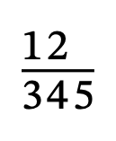

```xml
<math xmlns="http://www.w3.org/1998/Math/MathML"><mstack stackalign="center"><mn>12</mn><msline/><mn>345</mn></mstack></math>
```

</details>

### S05: Comma alignment and a blank cell

**Review:** Does the reading distinguish the blank column from omitted content and the alignment reference from digit zero?

**English (`en`)**

> stack with 2 rows alignment decimal point row 1: column minus 3: plus column minus 2: one column minus 1: two column 0: comma column 1: three column 2: blank row 2: column minus 1: four end stack

**French (`fr`)**

> opération posée de 2 lignes alignement sur le séparateur décimal ligne 1 : colonne moins 3: plus colonne moins 2: un colonne moins 1: deux colonne 0: virgule colonne 1: trois colonne 2: vide ligne 2 : colonne moins 1: quatre fin de l'opération

**German (`de`)**

> schriftliche Rechnung mit 2 Zeilen Ausrichtung am Dezimaltrennzeichen Zeile 1: Spalte minus 3: plus Spalte minus 2: eins Spalte minus 1: zwei Spalte 0: Komma Spalte 1: drei Spalte 2: leer Zeile 2: Spalte minus 1: vier Ende der Rechnung

**Spanish (`es`)**

> operación en columna de 2 filas alineación en el separador decimal fila 1: columna menos 3: más columna menos 2: uno columna menos 1: dos columna 0: coma columna 1: tres columna 2: vacío fila 2: columna menos 1: cuatro fin de la operación

**Italian (`it`)**

> operazione in colonna di 2 righe allineamento al separatore decimale riga 1: colonna meno 3: più colonna meno 2: uno colonna meno 1: due colonna 0: virgola colonna 1: tre colonna 2: vuoto riga 2: colonna meno 1: quattro fine dell'operazione

<details>
<summary>Reveal intended structure, rendered context and MathML</summary>

Two rows aligned on a comma: plus at -3, digits at -2,-1 and 1, comma at 0, blank at 2; second-row 4 at -1.

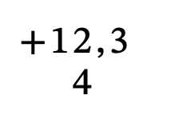

```xml
<math xmlns="http://www.w3.org/1998/Math/MathML"><mstyle decimalpoint=","><mstack><msrow><mo>+</mo><mn>12,3</mn><none/></msrow><mn>4</mn></mstack></mstyle></math>
```

</details>

### S06: Shifted decimal row and positive columns

**Review:** Are negative, zero and positive column references unambiguous when the point itself moves away from column zero?

**English (`en`)**

> stack with 2 rows alignment decimal point row 1: column minus 1: one column 0: point column 1: two row 2: column 0: three column 1: point column 2: four line column minus 2: column 0: end stack

**French (`fr`)**

> opération posée de 2 lignes alignement sur le séparateur décimal ligne 1 : colonne moins 1: un colonne 0: point colonne 1: deux ligne 2 : colonne 0: trois colonne 1: point colonne 2: quatre trait colonne moins 2: colonne 0: fin de l'opération

**German (`de`)**

> schriftliche Rechnung mit 2 Zeilen Ausrichtung am Dezimaltrennzeichen Zeile 1: Spalte minus 1: eins Spalte 0: Punkt Spalte 1: zwei Zeile 2: Spalte 0: drei Spalte 1: Punkt Spalte 2: vier Strich Spalte minus 2: Spalte 0: Ende der Rechnung

**Spanish (`es`)**

> operación en columna de 2 filas alineación en el separador decimal fila 1: columna menos 1: uno columna 0: punto columna 1: dos fila 2: columna 0: tres columna 1: punto columna 2: cuatro línea columna menos 2: columna 0: fin de la operación

**Italian (`it`)**

> operazione in colonna di 2 righe allineamento al separatore decimale riga 1: colonna meno 1: uno colonna 0: punto colonna 1: due riga 2: colonna 0: tre colonna 1: punto colonna 2: quattro linea colonna meno 2: colonna 0: fine dell'operazione

<details>
<summary>Reveal intended structure, rendered context and MathML</summary>

First row occupies -1,0,1; the second row shifts right to 0,1,2. The finite line spans -2 through 0.

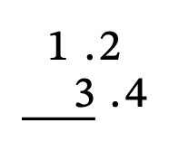

```xml
<math xmlns="http://www.w3.org/1998/Math/MathML"><mstack><mn>1.2</mn><msrow position="-1"><mn>3.4</mn></msrow><msline position="-1" length="3"/></mstack></math>
```

</details>


## Carries, borrows and crossouts

<a id="carries"></a>

### C01: Annotation left

**Review:** Does the complete carry/borrow label and location identify the annotation relative to the digit, without selecting an arithmetic operation?

**English (`en`)**

> stack with 1 row alignment left carries or borrows: column 0: left one row 1: column 0: two end stack

**French (`fr`)**

> opération posée de 1 ligne alignement à gauche retenues ou emprunts : colonne 0: à gauche un ligne 1 : colonne 0: deux fin de l'opération

**German (`de`)**

> schriftliche Rechnung mit 1 Zeile Ausrichtung links Überträge oder Entlehnungen: Spalte 0: links eins Zeile 1: Spalte 0: zwei Ende der Rechnung

**Spanish (`es`)**

> operación en columna de 1 fila alineación a la izquierda acarreos o préstamos: columna 0: a la izquierda uno fila 1: columna 0: dos fin de la operación

**Italian (`it`)**

> operazione in colonna di 1 riga allineamento a sinistra riporti o prestiti: colonna 0: a sinistra uno riga 1: colonna 0: due fine dell'operazione

<details>
<summary>Reveal intended structure, rendered context and MathML</summary>

Annotation 1 is left of digit 2 in column 0; there is no crossout.

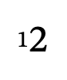

```xml
<math xmlns="http://www.w3.org/1998/Math/MathML"><mstack stackalign="left"><mscarries location="w"><mn>1</mn></mscarries><mn>2</mn></mstack></math>
```

</details>

### C02: Annotation above left

**Review:** Does the complete carry/borrow label and location identify the annotation relative to the digit, without selecting an arithmetic operation?

**English (`en`)**

> stack with 1 row alignment left carries or borrows: column 0: above left one row 1: column 0: two end stack

**French (`fr`)**

> opération posée de 1 ligne alignement à gauche retenues ou emprunts : colonne 0: en haut à gauche un ligne 1 : colonne 0: deux fin de l'opération

**German (`de`)**

> schriftliche Rechnung mit 1 Zeile Ausrichtung links Überträge oder Entlehnungen: Spalte 0: oben links eins Zeile 1: Spalte 0: zwei Ende der Rechnung

**Spanish (`es`)**

> operación en columna de 1 fila alineación a la izquierda acarreos o préstamos: columna 0: arriba a la izquierda uno fila 1: columna 0: dos fin de la operación

**Italian (`it`)**

> operazione in colonna di 1 riga allineamento a sinistra riporti o prestiti: colonna 0: in alto a sinistra uno riga 1: colonna 0: due fine dell'operazione

<details>
<summary>Reveal intended structure, rendered context and MathML</summary>

Annotation 1 is above left of digit 2 in column 0; there is no crossout.

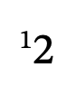

```xml
<math xmlns="http://www.w3.org/1998/Math/MathML"><mstack stackalign="left"><mscarries location="nw"><mn>1</mn></mscarries><mn>2</mn></mstack></math>
```

</details>

### C03: Annotation above

**Review:** Does the complete carry/borrow label and location identify the annotation relative to the digit, without selecting an arithmetic operation?

**English (`en`)**

> stack with 1 row alignment left carries or borrows: column 0: above one row 1: column 0: two end stack

**French (`fr`)**

> opération posée de 1 ligne alignement à gauche retenues ou emprunts : colonne 0: au-dessus un ligne 1 : colonne 0: deux fin de l'opération

**German (`de`)**

> schriftliche Rechnung mit 1 Zeile Ausrichtung links Überträge oder Entlehnungen: Spalte 0: oben eins Zeile 1: Spalte 0: zwei Ende der Rechnung

**Spanish (`es`)**

> operación en columna de 1 fila alineación a la izquierda acarreos o préstamos: columna 0: arriba uno fila 1: columna 0: dos fin de la operación

**Italian (`it`)**

> operazione in colonna di 1 riga allineamento a sinistra riporti o prestiti: colonna 0: sopra uno riga 1: colonna 0: due fine dell'operazione

<details>
<summary>Reveal intended structure, rendered context and MathML</summary>

Annotation 1 is above of digit 2 in column 0; there is no crossout.

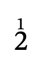

```xml
<math xmlns="http://www.w3.org/1998/Math/MathML"><mstack stackalign="left"><mscarries location="n"><mn>1</mn></mscarries><mn>2</mn></mstack></math>
```

</details>

### C04: Annotation above right

**Review:** Does the complete carry/borrow label and location identify the annotation relative to the digit, without selecting an arithmetic operation?

**English (`en`)**

> stack with 1 row alignment left carries or borrows: column 0: above right one row 1: column 0: two end stack

**French (`fr`)**

> opération posée de 1 ligne alignement à gauche retenues ou emprunts : colonne 0: en haut à droite un ligne 1 : colonne 0: deux fin de l'opération

**German (`de`)**

> schriftliche Rechnung mit 1 Zeile Ausrichtung links Überträge oder Entlehnungen: Spalte 0: oben rechts eins Zeile 1: Spalte 0: zwei Ende der Rechnung

**Spanish (`es`)**

> operación en columna de 1 fila alineación a la izquierda acarreos o préstamos: columna 0: arriba a la derecha uno fila 1: columna 0: dos fin de la operación

**Italian (`it`)**

> operazione in colonna di 1 riga allineamento a sinistra riporti o prestiti: colonna 0: in alto a destra uno riga 1: colonna 0: due fine dell'operazione

<details>
<summary>Reveal intended structure, rendered context and MathML</summary>

Annotation 1 is above right of digit 2 in column 0; there is no crossout.

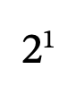

```xml
<math xmlns="http://www.w3.org/1998/Math/MathML"><mstack stackalign="left"><mscarries location="ne"><mn>1</mn></mscarries><mn>2</mn></mstack></math>
```

</details>

### C05: Annotation right

**Review:** Does the complete carry/borrow label and location identify the annotation relative to the digit, without selecting an arithmetic operation?

**English (`en`)**

> stack with 1 row alignment left carries or borrows: column 0: right one row 1: column 0: two end stack

**French (`fr`)**

> opération posée de 1 ligne alignement à gauche retenues ou emprunts : colonne 0: à droite un ligne 1 : colonne 0: deux fin de l'opération

**German (`de`)**

> schriftliche Rechnung mit 1 Zeile Ausrichtung links Überträge oder Entlehnungen: Spalte 0: rechts eins Zeile 1: Spalte 0: zwei Ende der Rechnung

**Spanish (`es`)**

> operación en columna de 1 fila alineación a la izquierda acarreos o préstamos: columna 0: a la derecha uno fila 1: columna 0: dos fin de la operación

**Italian (`it`)**

> operazione in colonna di 1 riga allineamento a sinistra riporti o prestiti: colonna 0: a destra uno riga 1: colonna 0: due fine dell'operazione

<details>
<summary>Reveal intended structure, rendered context and MathML</summary>

Annotation 1 is right of digit 2 in column 0; there is no crossout.

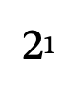

```xml
<math xmlns="http://www.w3.org/1998/Math/MathML"><mstack stackalign="left"><mscarries location="e"><mn>1</mn></mscarries><mn>2</mn></mstack></math>
```

</details>

### C06: Annotation below right

**Review:** Does the complete carry/borrow label and location identify the annotation relative to the digit, without selecting an arithmetic operation?

**English (`en`)**

> stack with 1 row alignment left carries or borrows: column 0: below right one row 1: column 0: two end stack

**French (`fr`)**

> opération posée de 1 ligne alignement à gauche retenues ou emprunts : colonne 0: en bas à droite un ligne 1 : colonne 0: deux fin de l'opération

**German (`de`)**

> schriftliche Rechnung mit 1 Zeile Ausrichtung links Überträge oder Entlehnungen: Spalte 0: unten rechts eins Zeile 1: Spalte 0: zwei Ende der Rechnung

**Spanish (`es`)**

> operación en columna de 1 fila alineación a la izquierda acarreos o préstamos: columna 0: abajo a la derecha uno fila 1: columna 0: dos fin de la operación

**Italian (`it`)**

> operazione in colonna di 1 riga allineamento a sinistra riporti o prestiti: colonna 0: in basso a destra uno riga 1: colonna 0: due fine dell'operazione

<details>
<summary>Reveal intended structure, rendered context and MathML</summary>

Annotation 1 is below right of digit 2 in column 0; there is no crossout.

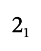

```xml
<math xmlns="http://www.w3.org/1998/Math/MathML"><mstack stackalign="left"><mscarries location="se"><mn>1</mn></mscarries><mn>2</mn></mstack></math>
```

</details>

### C07: Annotation below

**Review:** Does the complete carry/borrow label and location identify the annotation relative to the digit, without selecting an arithmetic operation?

**English (`en`)**

> stack with 1 row alignment left carries or borrows: column 0: below one row 1: column 0: two end stack

**French (`fr`)**

> opération posée de 1 ligne alignement à gauche retenues ou emprunts : colonne 0: en dessous un ligne 1 : colonne 0: deux fin de l'opération

**German (`de`)**

> schriftliche Rechnung mit 1 Zeile Ausrichtung links Überträge oder Entlehnungen: Spalte 0: unten eins Zeile 1: Spalte 0: zwei Ende der Rechnung

**Spanish (`es`)**

> operación en columna de 1 fila alineación a la izquierda acarreos o préstamos: columna 0: abajo uno fila 1: columna 0: dos fin de la operación

**Italian (`it`)**

> operazione in colonna di 1 riga allineamento a sinistra riporti o prestiti: colonna 0: sotto uno riga 1: colonna 0: due fine dell'operazione

<details>
<summary>Reveal intended structure, rendered context and MathML</summary>

Annotation 1 is below of digit 2 in column 0; there is no crossout.

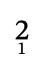

```xml
<math xmlns="http://www.w3.org/1998/Math/MathML"><mstack stackalign="left"><mscarries location="s"><mn>1</mn></mscarries><mn>2</mn></mstack></math>
```

</details>

### C08: Annotation below left

**Review:** Does the complete carry/borrow label and location identify the annotation relative to the digit, without selecting an arithmetic operation?

**English (`en`)**

> stack with 1 row alignment left carries or borrows: column 0: below left one row 1: column 0: two end stack

**French (`fr`)**

> opération posée de 1 ligne alignement à gauche retenues ou emprunts : colonne 0: en bas à gauche un ligne 1 : colonne 0: deux fin de l'opération

**German (`de`)**

> schriftliche Rechnung mit 1 Zeile Ausrichtung links Überträge oder Entlehnungen: Spalte 0: unten links eins Zeile 1: Spalte 0: zwei Ende der Rechnung

**Spanish (`es`)**

> operación en columna de 1 fila alineación a la izquierda acarreos o préstamos: columna 0: abajo a la izquierda uno fila 1: columna 0: dos fin de la operación

**Italian (`it`)**

> operazione in colonna di 1 riga allineamento a sinistra riporti o prestiti: colonna 0: in basso a sinistra uno riga 1: colonna 0: due fine dell'operazione

<details>
<summary>Reveal intended structure, rendered context and MathML</summary>

Annotation 1 is below left of digit 2 in column 0; there is no crossout.

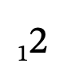

```xml
<math xmlns="http://www.w3.org/1998/Math/MathML"><mstack stackalign="left"><mscarries location="sw"><mn>1</mn></mscarries><mn>2</mn></mstack></math>
```

</details>

### C09: Upward diagonal (bottom left to top right) crossout

**Review:** Can the listener identify both the strike direction and the struck column digit? German: does this sound distinct from a prime?

**English (`en`)**

> stack with 1 row alignment left carries or borrows: column 0: above right one with the column's digit crossed out upward diagonal strike row 1: column 0: two end stack

**French (`fr`)**

> opération posée de 1 ligne alignement à gauche retenues ou emprunts : colonne 0: en haut à droite un avec le chiffre de la colonne barré trait diagonal montant ligne 1 : colonne 0: deux fin de l'opération

**German (`de`)**

> schriftliche Rechnung mit 1 Zeile Ausrichtung links Überträge oder Entlehnungen: Spalte 0: oben rechts eins mit durchgestrichener Ziffer in dieser Spalte aufsteigender diagonaler Strich Zeile 1: Spalte 0: zwei Ende der Rechnung

**Spanish (`es`)**

> operación en columna de 1 fila alineación a la izquierda acarreos o préstamos: columna 0: arriba a la derecha uno con la cifra de la columna tachada tachado diagonal ascendente fila 1: columna 0: dos fin de la operación

**Italian (`it`)**

> operazione in colonna di 1 riga allineamento a sinistra riporti o prestiti: colonna 0: in alto a destra uno con la cifra della colonna barrata barratura diagonale ascendente riga 1: colonna 0: due fine dell'operazione

<details>
<summary>Reveal intended structure, rendered context and MathML</summary>

Annotation 1 sits above right of digit 2 at column 0; digit 2 has a upward diagonal (bottom left to top right) strike. Annotation 1 is not the struck target.

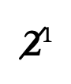

```xml
<math xmlns="http://www.w3.org/1998/Math/MathML"><mstack stackalign="left"><mscarries location="ne" crossout="updiagonalstrike"><mn>1</mn></mscarries><mn>2</mn></mstack></math>
```

</details>

### C10: Downward diagonal (top left to bottom right) crossout

**Review:** Can the listener identify both the strike direction and the struck column digit? German: does this sound distinct from a prime?

**English (`en`)**

> stack with 1 row alignment left carries or borrows: column 0: above right one with the column's digit crossed out downward diagonal strike row 1: column 0: two end stack

**French (`fr`)**

> opération posée de 1 ligne alignement à gauche retenues ou emprunts : colonne 0: en haut à droite un avec le chiffre de la colonne barré trait diagonal descendant ligne 1 : colonne 0: deux fin de l'opération

**German (`de`)**

> schriftliche Rechnung mit 1 Zeile Ausrichtung links Überträge oder Entlehnungen: Spalte 0: oben rechts eins mit durchgestrichener Ziffer in dieser Spalte absteigender diagonaler Strich Zeile 1: Spalte 0: zwei Ende der Rechnung

**Spanish (`es`)**

> operación en columna de 1 fila alineación a la izquierda acarreos o préstamos: columna 0: arriba a la derecha uno con la cifra de la columna tachada tachado diagonal descendente fila 1: columna 0: dos fin de la operación

**Italian (`it`)**

> operazione in colonna di 1 riga allineamento a sinistra riporti o prestiti: colonna 0: in alto a destra uno con la cifra della colonna barrata barratura diagonale discendente riga 1: colonna 0: due fine dell'operazione

<details>
<summary>Reveal intended structure, rendered context and MathML</summary>

Annotation 1 sits above right of digit 2 at column 0; digit 2 has a downward diagonal (top left to bottom right) strike. Annotation 1 is not the struck target.

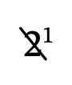

```xml
<math xmlns="http://www.w3.org/1998/Math/MathML"><mstack stackalign="left"><mscarries location="ne" crossout="downdiagonalstrike"><mn>1</mn></mscarries><mn>2</mn></mstack></math>
```

</details>

### C11: Vertical crossout

**Review:** Can the listener identify both the strike direction and the struck column digit? German: does this sound distinct from a prime?

**English (`en`)**

> stack with 1 row alignment left carries or borrows: column 0: above right one with the column's digit crossed out vertical strike row 1: column 0: two end stack

**French (`fr`)**

> opération posée de 1 ligne alignement à gauche retenues ou emprunts : colonne 0: en haut à droite un avec le chiffre de la colonne barré trait vertical ligne 1 : colonne 0: deux fin de l'opération

**German (`de`)**

> schriftliche Rechnung mit 1 Zeile Ausrichtung links Überträge oder Entlehnungen: Spalte 0: oben rechts eins mit durchgestrichener Ziffer in dieser Spalte senkrechter Strich Zeile 1: Spalte 0: zwei Ende der Rechnung

**Spanish (`es`)**

> operación en columna de 1 fila alineación a la izquierda acarreos o préstamos: columna 0: arriba a la derecha uno con la cifra de la columna tachada tachado vertical fila 1: columna 0: dos fin de la operación

**Italian (`it`)**

> operazione in colonna di 1 riga allineamento a sinistra riporti o prestiti: colonna 0: in alto a destra uno con la cifra della colonna barrata barratura verticale riga 1: colonna 0: due fine dell'operazione

<details>
<summary>Reveal intended structure, rendered context and MathML</summary>

Annotation 1 sits above right of digit 2 at column 0; digit 2 has a vertical strike. Annotation 1 is not the struck target.

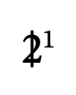

```xml
<math xmlns="http://www.w3.org/1998/Math/MathML"><mstack stackalign="left"><mscarries location="ne" crossout="verticalstrike"><mn>1</mn></mscarries><mn>2</mn></mstack></math>
```

</details>

### C12: Horizontal crossout

**Review:** Can the listener identify both the strike direction and the struck column digit? German: does this sound distinct from a prime?

**English (`en`)**

> stack with 1 row alignment left carries or borrows: column 0: above right one with the column's digit crossed out horizontal strike row 1: column 0: two end stack

**French (`fr`)**

> opération posée de 1 ligne alignement à gauche retenues ou emprunts : colonne 0: en haut à droite un avec le chiffre de la colonne barré trait horizontal ligne 1 : colonne 0: deux fin de l'opération

**German (`de`)**

> schriftliche Rechnung mit 1 Zeile Ausrichtung links Überträge oder Entlehnungen: Spalte 0: oben rechts eins mit durchgestrichener Ziffer in dieser Spalte waagerechter Strich Zeile 1: Spalte 0: zwei Ende der Rechnung

**Spanish (`es`)**

> operación en columna de 1 fila alineación a la izquierda acarreos o préstamos: columna 0: arriba a la derecha uno con la cifra de la columna tachada tachado horizontal fila 1: columna 0: dos fin de la operación

**Italian (`it`)**

> operazione in colonna di 1 riga allineamento a sinistra riporti o prestiti: colonna 0: in alto a destra uno con la cifra della colonna barrata barratura orizzontale riga 1: colonna 0: due fine dell'operazione

<details>
<summary>Reveal intended structure, rendered context and MathML</summary>

Annotation 1 sits above right of digit 2 at column 0; digit 2 has a horizontal strike. Annotation 1 is not the struck target.

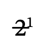

```xml
<math xmlns="http://www.w3.org/1998/Math/MathML"><mstack stackalign="left"><mscarries location="ne" crossout="horizontalstrike"><mn>1</mn></mscarries><mn>2</mn></mstack></math>
```

</details>

### C13: Combined strikes, an override and a blank

**Review:** Does the ordering keep each location, annotation and crossout associated with its own column? Is the combined wording natural?

**English (`en`)**

> stack with 1 row alignment left carries or borrows: column 0: below right one two with the column's digit crossed out upward diagonal strike downward diagonal strike vertical strike horizontal strike column 1: left three column 2: blank row 1: column 0: four column 1: five column 2: six end stack

**French (`fr`)**

> opération posée de 1 ligne alignement à gauche retenues ou emprunts : colonne 0: en bas à droite un deux avec le chiffre de la colonne barré trait diagonal montant trait diagonal descendant trait vertical trait horizontal colonne 1: à gauche trois colonne 2: vide ligne 1 : colonne 0: quatre colonne 1: cinq colonne 2: six fin de l'opération

**German (`de`)**

> schriftliche Rechnung mit 1 Zeile Ausrichtung links Überträge oder Entlehnungen: Spalte 0: unten rechts eins zwei mit durchgestrichener Ziffer in dieser Spalte aufsteigender diagonaler Strich absteigender diagonaler Strich senkrechter Strich waagerechter Strich Spalte 1: links drei Spalte 2: leer Zeile 1: Spalte 0: vier Spalte 1: fünf Spalte 2: sechs Ende der Rechnung

**Spanish (`es`)**

> operación en columna de 1 fila alineación a la izquierda acarreos o préstamos: columna 0: abajo a la derecha uno dos con la cifra de la columna tachada tachado diagonal ascendente tachado diagonal descendente tachado vertical tachado horizontal columna 1: a la izquierda tres columna 2: vacío fila 1: columna 0: cuatro columna 1: cinco columna 2: seis fin de la operación

**Italian (`it`)**

> operazione in colonna di 1 riga allineamento a sinistra riporti o prestiti: colonna 0: in basso a destra uno due con la cifra della colonna barrata barratura diagonale ascendente barratura diagonale discendente barratura verticale barratura orizzontale colonna 1: a sinistra tre colonna 2: vuoto riga 1: colonna 0: quattro colonna 1: cinque colonna 2: sei fine dell'operazione

<details>
<summary>Reveal intended structure, rendered context and MathML</summary>

Column 0: annotation 12 below right, digit 4 struck in all four directions. Column 1: annotation 3 left of unstruck digit 5. Column 2: blank annotation over digit 6.

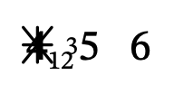

```xml
<math xmlns="http://www.w3.org/1998/Math/MathML"><mstack stackalign="left"><mscarries location="se" crossout="updiagonalstrike downdiagonalstrike verticalstrike horizontalstrike"><mn>12</mn><mscarry location="w" crossout="none"><mn>3</mn></mscarry><none/></mscarries><mn>456</mn></mstack></math>
```

</details>

### C14: Carry terminology in an addition context

**Review:** Is the combined category acceptable in addition? State regional classroom terminology and a full replacement if the label is confusing.

**English (`en`)**

> stack with 3 rows alignment right carries or borrows: column minus 2: above one column minus 1: blank row 1: column minus 2: one column minus 1: eight row 2: column minus 3: plus column minus 2: two column minus 1: seven line across the whole stack row 3: column minus 2: four column minus 1: five end stack

**French (`fr`)**

> opération posée de 3 lignes alignement à droite retenues ou emprunts : colonne moins 2: au-dessus un colonne moins 1: vide ligne 1 : colonne moins 2: un colonne moins 1: huit ligne 2 : colonne moins 3: plus colonne moins 2: deux colonne moins 1: sept trait sur toute la largeur de l’opération ligne 3 : colonne moins 2: quatre colonne moins 1: cinq fin de l'opération

**German (`de`)**

> schriftliche Rechnung mit 3 Zeilen Ausrichtung rechts Überträge oder Entlehnungen: Spalte minus 2: oben eins Spalte minus 1: leer Zeile 1: Spalte minus 2: eins Spalte minus 1: acht Zeile 2: Spalte minus 3: plus Spalte minus 2: zwei Spalte minus 1: sieben Strich über die gesamte Rechnung Zeile 3: Spalte minus 2: vier Spalte minus 1: fünf Ende der Rechnung

**Spanish (`es`)**

> operación en columna de 3 filas alineación a la derecha acarreos o préstamos: columna menos 2: arriba uno columna menos 1: vacío fila 1: columna menos 2: uno columna menos 1: ocho fila 2: columna menos 3: más columna menos 2: dos columna menos 1: siete línea en todo el ancho de la operación fila 3: columna menos 2: cuatro columna menos 1: cinco fin de la operación

**Italian (`it`)**

> operazione in colonna di 3 righe allineamento a destra riporti o prestiti: colonna meno 2: sopra uno colonna meno 1: vuoto riga 1: colonna meno 2: uno colonna meno 1: otto riga 2: colonna meno 3: più colonna meno 2: due colonna meno 1: sette linea su tutta la larghezza dell’operazione riga 3: colonna meno 2: quattro colonna meno 1: cinque fine dell'operazione

<details>
<summary>Reveal intended structure, rendered context and MathML</summary>

Written addition 18 + 27 = 45 with annotation 1 above the tens column (-2); no crossout. The category still says carries or borrows.

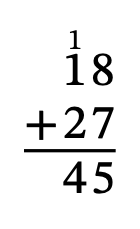

```xml
<math xmlns="http://www.w3.org/1998/Math/MathML"><mstack stackalign="right"><mscarries><mn>1</mn><none/></mscarries><mn>18</mn><msrow><mo>+</mo><mn>27</mn></msrow><msline/><mn>45</mn></mstack></math>
```

</details>

### C15: Borrow terminology in a subtraction context

**Review:** Is the same category acceptable for borrowing? Assess regional alternatives in context, including Spanish terminology; do not request an arithmetic-guessing heuristic.

**English (`en`)**

> stack with 3 rows alignment right carries or borrows: column minus 2: above two with the column's digit crossed out upward diagonal strike column minus 1: above one row 1: column minus 2: three column minus 1: two row 2: column minus 3: minus column minus 2: one column minus 1: seven line across the whole stack row 3: column minus 2: one column minus 1: five end stack

**French (`fr`)**

> opération posée de 3 lignes alignement à droite retenues ou emprunts : colonne moins 2: au-dessus deux avec le chiffre de la colonne barré trait diagonal montant colonne moins 1: au-dessus un ligne 1 : colonne moins 2: trois colonne moins 1: deux ligne 2 : colonne moins 3: moins colonne moins 2: un colonne moins 1: sept trait sur toute la largeur de l’opération ligne 3 : colonne moins 2: un colonne moins 1: cinq fin de l'opération

**German (`de`)**

> schriftliche Rechnung mit 3 Zeilen Ausrichtung rechts Überträge oder Entlehnungen: Spalte minus 2: oben zwei mit durchgestrichener Ziffer in dieser Spalte aufsteigender diagonaler Strich Spalte minus 1: oben eins Zeile 1: Spalte minus 2: drei Spalte minus 1: zwei Zeile 2: Spalte minus 3: minus Spalte minus 2: eins Spalte minus 1: sieben Strich über die gesamte Rechnung Zeile 3: Spalte minus 2: eins Spalte minus 1: fünf Ende der Rechnung

**Spanish (`es`)**

> operación en columna de 3 filas alineación a la derecha acarreos o préstamos: columna menos 2: arriba dos con la cifra de la columna tachada tachado diagonal ascendente columna menos 1: arriba uno fila 1: columna menos 2: tres columna menos 1: dos fila 2: columna menos 3: menos columna menos 2: uno columna menos 1: siete línea en todo el ancho de la operación fila 3: columna menos 2: uno columna menos 1: cinco fin de la operación

**Italian (`it`)**

> operazione in colonna di 3 righe allineamento a destra riporti o prestiti: colonna meno 2: sopra due con la cifra della colonna barrata barratura diagonale ascendente colonna meno 1: sopra uno riga 1: colonna meno 2: tre colonna meno 1: due riga 2: colonna meno 3: meno colonna meno 2: uno colonna meno 1: sette linea su tutta la larghezza dell’operazione riga 3: colonna meno 2: uno colonna meno 1: cinque fine dell'operazione

<details>
<summary>Reveal intended structure, rendered context and MathML</summary>

Written subtraction 32 − 17 = 15. Annotation 2 is above tens column (-2) with digit 3 struck upward; annotation 1 is above units column (-1). The combined category is unchanged.

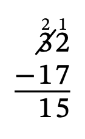

```xml
<math xmlns="http://www.w3.org/1998/Math/MathML"><mstack stackalign="right"><mscarries><mscarry crossout="updiagonalstrike"><mn>2</mn></mscarry><mn>1</mn></mscarries><mn>32</mn><msrow><mo>−</mo><mn>17</mn></msrow><msline/><mn>15</mn></mstack></math>
```

</details>


## Long-division frames and working rows

<a id="division"></a>

### D01: Frame lefttop

**Review:** Does the frame description match the image, distinguish the other frames, and preserve divisor/dividend/result and working-row boundaries?

**English (`en`)**

> long division divisor left, result above alignment decimal point divisor: three dividend: column minus 3: one column minus 2: two column minus 1: three result: column minus 2: four column minus 1: one end long division

**French (`fr`)**

> division posée diviseur à gauche, résultat au-dessus alignement sur le séparateur décimal diviseur : trois dividende : colonne moins 3: un colonne moins 2: deux colonne moins 1: trois résultat : colonne moins 2: quatre colonne moins 1: un fin de la division

**German (`de`)**

> schriftliche Division Divisor links, Ergebnis oben Ausrichtung am Dezimaltrennzeichen Divisor: drei Dividend: Spalte minus 3: eins Spalte minus 2: zwei Spalte minus 1: drei Ergebnis: Spalte minus 2: vier Spalte minus 1: eins Ende der Division

**Spanish (`es`)**

> división larga divisor a la izquierda, resultado arriba alineación en el separador decimal divisor: tres dividendo: columna menos 3: uno columna menos 2: dos columna menos 1: tres resultado: columna menos 2: cuatro columna menos 1: uno fin de la división

**Italian (`it`)**

> divisione in colonna divisore a sinistra, risultato sopra allineamento al separatore decimale divisore: tre dividendo: colonna meno 3: uno colonna meno 2: due colonna meno 1: tre risultato: colonna meno 2: quattro colonna meno 1: uno fine della divisione

<details>
<summary>Reveal intended structure, rendered context and MathML</summary>

Divisor left; result above the dividend. Divisor 3, result 41, dividend 123.

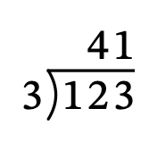

```xml
<math xmlns="http://www.w3.org/1998/Math/MathML"><mlongdiv longdivstyle="lefttop"><mn>3</mn><mn>41</mn><mn>123</mn></mlongdiv></math>
```

</details>

### D02: Frame stackedrightright

**Review:** Does the frame description match the image, distinguish the other frames, and preserve divisor/dividend/result and working-row boundaries?

**English (`en`)**

> long division divisor and result stacked right, full vertical line alignment decimal point divisor: three dividend: column minus 3: one column minus 2: two column minus 1: three result: four one end long division

**French (`fr`)**

> division posée diviseur et résultat à droite, trait vertical complet alignement sur le séparateur décimal diviseur : trois dividende : colonne moins 3: un colonne moins 2: deux colonne moins 1: trois résultat : quatre un fin de la division

**German (`de`)**

> schriftliche Division Divisor und Ergebnis rechts, volle senkrechte Linie Ausrichtung am Dezimaltrennzeichen Divisor: drei Dividend: Spalte minus 3: eins Spalte minus 2: zwei Spalte minus 1: drei Ergebnis: vier eins Ende der Division

**Spanish (`es`)**

> división larga divisor y resultado a la derecha, línea vertical completa alineación en el separador decimal divisor: tres dividendo: columna menos 3: uno columna menos 2: dos columna menos 1: tres resultado: cuatro uno fin de la división

**Italian (`it`)**

> divisione in colonna divisore e risultato a destra, linea verticale completa allineamento al separatore decimale divisore: tre dividendo: colonna meno 3: uno colonna meno 2: due colonna meno 1: tre risultato: quattro uno fine della divisione

<details>
<summary>Reveal intended structure, rendered context and MathML</summary>

Divisor and result stacked on the right; full vertical line. Divisor 3, result 41, dividend 123.


```xml
<math xmlns="http://www.w3.org/1998/Math/MathML"><mlongdiv longdivstyle="stackedrightright"><mn>3</mn><mn>41</mn><mn>123</mn></mlongdiv></math>
```

</details>

### D03: Frame mediumstackedrightright

**Review:** Does the frame description match the image, distinguish the other frames, and preserve divisor/dividend/result and working-row boundaries?

**English (`en`)**

> long division divisor and result stacked right, medium vertical line alignment decimal point divisor: three dividend: column minus 3: one column minus 2: two column minus 1: three result: four one end long division

**French (`fr`)**

> division posée diviseur et résultat à droite, trait vertical moyen alignement sur le séparateur décimal diviseur : trois dividende : colonne moins 3: un colonne moins 2: deux colonne moins 1: trois résultat : quatre un fin de la division

**German (`de`)**

> schriftliche Division Divisor und Ergebnis rechts, mittlere senkrechte Linie Ausrichtung am Dezimaltrennzeichen Divisor: drei Dividend: Spalte minus 3: eins Spalte minus 2: zwei Spalte minus 1: drei Ergebnis: vier eins Ende der Division

**Spanish (`es`)**

> división larga divisor y resultado a la derecha, línea vertical media alineación en el separador decimal divisor: tres dividendo: columna menos 3: uno columna menos 2: dos columna menos 1: tres resultado: cuatro uno fin de la división

**Italian (`it`)**

> divisione in colonna divisore e risultato a destra, linea verticale media allineamento al separatore decimale divisore: tre dividendo: colonna meno 3: uno colonna meno 2: due colonna meno 1: tre risultato: quattro uno fine della divisione

<details>
<summary>Reveal intended structure, rendered context and MathML</summary>

Divisor and result stacked on the right; medium vertical line. Divisor 3, result 41, dividend 123.

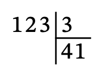

```xml
<math xmlns="http://www.w3.org/1998/Math/MathML"><mlongdiv longdivstyle="mediumstackedrightright"><mn>3</mn><mn>41</mn><mn>123</mn></mlongdiv></math>
```

</details>

### D04: Frame shortstackedrightright

**Review:** Does the frame description match the image, distinguish the other frames, and preserve divisor/dividend/result and working-row boundaries?

**English (`en`)**

> long division divisor and result stacked right, short vertical line alignment decimal point divisor: three dividend: column minus 3: one column minus 2: two column minus 1: three result: four one end long division

**French (`fr`)**

> division posée diviseur et résultat à droite, trait vertical court alignement sur le séparateur décimal diviseur : trois dividende : colonne moins 3: un colonne moins 2: deux colonne moins 1: trois résultat : quatre un fin de la division

**German (`de`)**

> schriftliche Division Divisor und Ergebnis rechts, kurze senkrechte Linie Ausrichtung am Dezimaltrennzeichen Divisor: drei Dividend: Spalte minus 3: eins Spalte minus 2: zwei Spalte minus 1: drei Ergebnis: vier eins Ende der Division

**Spanish (`es`)**

> división larga divisor y resultado a la derecha, línea vertical corta alineación en el separador decimal divisor: tres dividendo: columna menos 3: uno columna menos 2: dos columna menos 1: tres resultado: cuatro uno fin de la división

**Italian (`it`)**

> divisione in colonna divisore e risultato a destra, linea verticale corta allineamento al separatore decimale divisore: tre dividendo: colonna meno 3: uno colonna meno 2: due colonna meno 1: tre risultato: quattro uno fine della divisione

<details>
<summary>Reveal intended structure, rendered context and MathML</summary>

Divisor and result stacked on the right; short vertical line. Divisor 3, result 41, dividend 123.

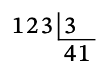

```xml
<math xmlns="http://www.w3.org/1998/Math/MathML"><mlongdiv longdivstyle="shortstackedrightright"><mn>3</mn><mn>41</mn><mn>123</mn></mlongdiv></math>
```

</details>

### D05: Frame righttop

**Review:** Does the frame description match the image, distinguish the other frames, and preserve divisor/dividend/result and working-row boundaries?

**English (`en`)**

> long division divisor right, result above alignment decimal point divisor: three dividend: column minus 3: one column minus 2: two column minus 1: three result: column minus 2: four column minus 1: one end long division

**French (`fr`)**

> division posée diviseur à droite, résultat au-dessus alignement sur le séparateur décimal diviseur : trois dividende : colonne moins 3: un colonne moins 2: deux colonne moins 1: trois résultat : colonne moins 2: quatre colonne moins 1: un fin de la division

**German (`de`)**

> schriftliche Division Divisor rechts, Ergebnis oben Ausrichtung am Dezimaltrennzeichen Divisor: drei Dividend: Spalte minus 3: eins Spalte minus 2: zwei Spalte minus 1: drei Ergebnis: Spalte minus 2: vier Spalte minus 1: eins Ende der Division

**Spanish (`es`)**

> división larga divisor a la derecha, resultado arriba alineación en el separador decimal divisor: tres dividendo: columna menos 3: uno columna menos 2: dos columna menos 1: tres resultado: columna menos 2: cuatro columna menos 1: uno fin de la división

**Italian (`it`)**

> divisione in colonna divisore a destra, risultato sopra allineamento al separatore decimale divisore: tre dividendo: colonna meno 3: uno colonna meno 2: due colonna meno 1: tre risultato: colonna meno 2: quattro colonna meno 1: uno fine della divisione

<details>
<summary>Reveal intended structure, rendered context and MathML</summary>

Divisor right; result above the dividend. Divisor 3, result 41, dividend 123.

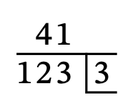

```xml
<math xmlns="http://www.w3.org/1998/Math/MathML"><mlongdiv longdivstyle="righttop"><mn>3</mn><mn>41</mn><mn>123</mn></mlongdiv></math>
```

</details>

### D06: Frame left/\right

**Review:** Does the frame description match the image, distinguish the other frames, and preserve divisor/dividend/result and working-row boundaries?

**English (`en`)**

> long division divisor left of slash, result right of backslash alignment decimal point divisor: three dividend: column minus 3: one column minus 2: two column minus 1: three result: four one end long division

**French (`fr`)**

> division posée diviseur à gauche d’une barre oblique, résultat à droite d’une barre oblique inverse alignement sur le séparateur décimal diviseur : trois dividende : colonne moins 3: un colonne moins 2: deux colonne moins 1: trois résultat : quatre un fin de la division

**German (`de`)**

> schriftliche Division Divisor links vom Schrägstrich, Ergebnis rechts vom umgekehrten Schrägstrich Ausrichtung am Dezimaltrennzeichen Divisor: drei Dividend: Spalte minus 3: eins Spalte minus 2: zwei Spalte minus 1: drei Ergebnis: vier eins Ende der Division

**Spanish (`es`)**

> división larga divisor a la izquierda de la barra, resultado a la derecha de la barra inversa alineación en el separador decimal divisor: tres dividendo: columna menos 3: uno columna menos 2: dos columna menos 1: tres resultado: cuatro uno fin de la división

**Italian (`it`)**

> divisione in colonna divisore a sinistra della barra, risultato a destra della barra inversa allineamento al separatore decimale divisore: tre dividendo: colonna meno 3: uno colonna meno 2: due colonna meno 1: tre risultato: quattro uno fine della divisione

<details>
<summary>Reveal intended structure, rendered context and MathML</summary>

Divisor left of a slash; result right of a backslash. Divisor 3, result 41, dividend 123.

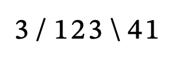

```xml
<math xmlns="http://www.w3.org/1998/Math/MathML"><mlongdiv longdivstyle="left/\right"><mn>3</mn><mn>41</mn><mn>123</mn></mlongdiv></math>
```

</details>

### D07: Frame left)(right

**Review:** Does the frame description match the image, distinguish the other frames, and preserve divisor/dividend/result and working-row boundaries?

**English (`en`)**

> long division divisor left of closing parenthesis, result right of opening parenthesis alignment decimal point divisor: three dividend: column minus 3: one column minus 2: two column minus 1: three result: four one end long division

**French (`fr`)**

> division posée diviseur à gauche d’une parenthèse fermante, résultat à droite d’une parenthèse ouvrante alignement sur le séparateur décimal diviseur : trois dividende : colonne moins 3: un colonne moins 2: deux colonne moins 1: trois résultat : quatre un fin de la division

**German (`de`)**

> schriftliche Division Divisor links von der schließenden Klammer, Ergebnis rechts von der öffnenden Klammer Ausrichtung am Dezimaltrennzeichen Divisor: drei Dividend: Spalte minus 3: eins Spalte minus 2: zwei Spalte minus 1: drei Ergebnis: vier eins Ende der Division

**Spanish (`es`)**

> división larga divisor a la izquierda del paréntesis de cierre, resultado a la derecha del paréntesis de apertura alineación en el separador decimal divisor: tres dividendo: columna menos 3: uno columna menos 2: dos columna menos 1: tres resultado: cuatro uno fin de la división

**Italian (`it`)**

> divisione in colonna divisore a sinistra della parentesi chiusa, risultato a destra della parentesi aperta allineamento al separatore decimale divisore: tre dividendo: colonna meno 3: uno colonna meno 2: due colonna meno 1: tre risultato: quattro uno fine della divisione

<details>
<summary>Reveal intended structure, rendered context and MathML</summary>

Divisor left of a closing parenthesis; result right of an opening parenthesis. Divisor 3, result 41, dividend 123.

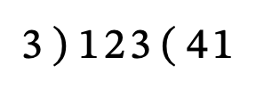

```xml
<math xmlns="http://www.w3.org/1998/Math/MathML"><mlongdiv longdivstyle="left)(right"><mn>3</mn><mn>41</mn><mn>123</mn></mlongdiv></math>
```

</details>

### D08: Frame :right=right

**Review:** Does the frame description match the image, distinguish the other frames, and preserve divisor/dividend/result and working-row boundaries?

**English (`en`)**

> long division divisor right of colon, result right of equals alignment decimal point divisor: three dividend: column minus 3: one column minus 2: two column minus 1: three result: four one end long division

**French (`fr`)**

> division posée diviseur à droite des deux-points, résultat à droite du signe égal alignement sur le séparateur décimal diviseur : trois dividende : colonne moins 3: un colonne moins 2: deux colonne moins 1: trois résultat : quatre un fin de la division

**German (`de`)**

> schriftliche Division Divisor rechts vom Doppelpunkt, Ergebnis rechts vom Gleichheitszeichen Ausrichtung am Dezimaltrennzeichen Divisor: drei Dividend: Spalte minus 3: eins Spalte minus 2: zwei Spalte minus 1: drei Ergebnis: vier eins Ende der Division

**Spanish (`es`)**

> división larga divisor a la derecha de los dos puntos, resultado a la derecha del signo igual alineación en el separador decimal divisor: tres dividendo: columna menos 3: uno columna menos 2: dos columna menos 1: tres resultado: cuatro uno fin de la división

**Italian (`it`)**

> divisione in colonna divisore a destra dei due punti, risultato a destra del segno uguale allineamento al separatore decimale divisore: tre dividendo: colonna meno 3: uno colonna meno 2: due colonna meno 1: tre risultato: quattro uno fine della divisione

<details>
<summary>Reveal intended structure, rendered context and MathML</summary>

Divisor right of a colon; result right of an equals sign. Divisor 3, result 41, dividend 123.

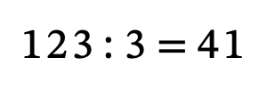

```xml
<math xmlns="http://www.w3.org/1998/Math/MathML"><mlongdiv longdivstyle=":right=right"><mn>3</mn><mn>41</mn><mn>123</mn></mlongdiv></math>
```

</details>

### D09: Frame stackedleftleft

**Review:** Does the frame description match the image, distinguish the other frames, and preserve divisor/dividend/result and working-row boundaries?

**English (`en`)**

> long division with 1 working row divisor and result stacked left alignment decimal point divisor: three dividend: column minus 3: one column minus 2: two column minus 1: three result: four one row 1: column minus 1: three line column minus 1: column minus 1: end long division

**French (`fr`)**

> division posée avec 1 ligne de calcul diviseur et résultat à gauche alignement sur le séparateur décimal diviseur : trois dividende : colonne moins 3: un colonne moins 2: deux colonne moins 1: trois résultat : quatre un ligne 1 : colonne moins 1: trois trait colonne moins 1: colonne moins 1: fin de la division

**German (`de`)**

> schriftliche Division mit 1 Rechenzeile Divisor und Ergebnis links Ausrichtung am Dezimaltrennzeichen Divisor: drei Dividend: Spalte minus 3: eins Spalte minus 2: zwei Spalte minus 1: drei Ergebnis: vier eins Zeile 1: Spalte minus 1: drei Strich Spalte minus 1: Spalte minus 1: Ende der Division

**Spanish (`es`)**

> división larga con 1 fila de cálculo divisor y resultado a la izquierda alineación en el separador decimal divisor: tres dividendo: columna menos 3: uno columna menos 2: dos columna menos 1: tres resultado: cuatro uno fila 1: columna menos 1: tres línea columna menos 1: columna menos 1: fin de la división

**Italian (`it`)**

> divisione in colonna con 1 riga di calcolo divisore e risultato a sinistra allineamento al separatore decimale divisore: tre dividendo: colonna meno 3: uno colonna meno 2: due colonna meno 1: tre risultato: quattro uno riga 1: colonna meno 1: tre linea colonna meno 1: colonna meno 1: fine della divisione

<details>
<summary>Reveal intended structure, rendered context and MathML</summary>

Divisor and result stacked on the left. Divisor 3, result 41, dividend 123. One working row (3) and a finite line follow the dividend.

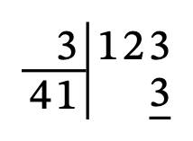

```xml
<math xmlns="http://www.w3.org/1998/Math/MathML"><mlongdiv longdivstyle="stackedleftleft"><mn>3</mn><mn>41</mn><mn>123</mn><mn>3</mn><msline length="1"/></mlongdiv></math>
```

</details>

### D10: Frame stackedleftlinetop

**Review:** Does the frame description match the image, distinguish the other frames, and preserve divisor/dividend/result and working-row boundaries?

**English (`en`)**

> long division with 2 working rows divisor left, result above with left vertical line alignment decimal point divisor: three dividend: column minus 3: one column minus 2: two column minus 1: three result: column minus 2: four column minus 1: one row 1: column minus 1: three line column minus 1: column minus 1: row 2: column 0: zero end long division

**French (`fr`)**

> division posée avec 2 lignes de calcul diviseur à gauche, résultat au-dessus avec trait vertical à gauche alignement sur le séparateur décimal diviseur : trois dividende : colonne moins 3: un colonne moins 2: deux colonne moins 1: trois résultat : colonne moins 2: quatre colonne moins 1: un ligne 1 : colonne moins 1: trois trait colonne moins 1: colonne moins 1: ligne 2 : colonne 0: zéro fin de la division

**German (`de`)**

> schriftliche Division mit 2 Rechenzeilen Divisor links, Ergebnis oben mit linker senkrechter Linie Ausrichtung am Dezimaltrennzeichen Divisor: drei Dividend: Spalte minus 3: eins Spalte minus 2: zwei Spalte minus 1: drei Ergebnis: Spalte minus 2: vier Spalte minus 1: eins Zeile 1: Spalte minus 1: drei Strich Spalte minus 1: Spalte minus 1: Zeile 2: Spalte 0: null Ende der Division

**Spanish (`es`)**

> división larga con 2 filas de cálculo divisor a la izquierda, resultado arriba con línea vertical izquierda alineación en el separador decimal divisor: tres dividendo: columna menos 3: uno columna menos 2: dos columna menos 1: tres resultado: columna menos 2: cuatro columna menos 1: uno fila 1: columna menos 1: tres línea columna menos 1: columna menos 1: fila 2: columna 0: cero fin de la división

**Italian (`it`)**

> divisione in colonna con 2 righe di calcolo divisore a sinistra, risultato sopra con linea verticale sinistra allineamento al separatore decimale divisore: tre dividendo: colonna meno 3: uno colonna meno 2: due colonna meno 1: tre risultato: colonna meno 2: quattro colonna meno 1: uno riga 1: colonna meno 1: tre linea colonna meno 1: colonna meno 1: riga 2: colonna 0: zero fine della divisione

<details>
<summary>Reveal intended structure, rendered context and MathML</summary>

Divisor left; result above the dividend with a left vertical line. Divisor 3, result 41, dividend 123. Two working rows (3, then shifted 0) and a finite line follow the dividend.

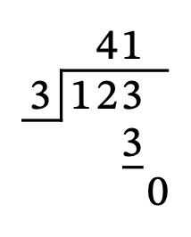

```xml
<math xmlns="http://www.w3.org/1998/Math/MathML"><mlongdiv longdivstyle="stackedleftlinetop"><mn>3</mn><mn>41</mn><mn>123</mn><mn>3</mn><msline length="1"/><msrow position="-1"><mn>0</mn></msrow></mlongdiv></math>
```

</details>


## Compound expression boundaries

<a id="scope"></a>

### P01: Compound scripts at all four corners

**Review:** Can a listener delimit all four expressions and tell that z is outside? Review closing phrases in combination, retaining the sourced positional labels.

**English (`en`)**

> T right subscript n plus 1 end subscript right superscript n plus 1 end superscript left subscript n plus 1 end subscript left superscript n plus 1 end superscript z

**French (`fr`)**

> T indice droite n plus 1 fin d'indice exposant droite n plus 1 fin d'exposant indice gauche n plus 1 fin d'indice exposant gauche n plus 1 fin d'exposant z

**German (`de`)**

> T rechter unterer Index n plus 1 Ende Index rechter oberer Index n plus 1 Ende Index linker unterer Index n plus 1 Ende Index linker oberer Index n plus 1 Ende Index z

**Spanish (`es`)**

> T subíndice derecho n más 1 fin de subíndice superíndice derecho n más 1 fin de superíndice subíndice izquierdo n más 1 fin de subíndice superíndice izquierdo n más 1 fin de superíndice z

**Italian (`it`)**

> T pedice destro n più 1 fine pedice apice destro n più 1 fine apice pedice sinistro n più 1 fine pedice apice sinistro n più 1 fine apice z

<details>
<summary>Reveal intended structure, rendered context and MathML</summary>

T has n+1 at each corner (right subscript, right superscript, left subscript, left superscript); z follows outside every script.

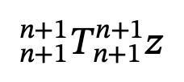

```xml
<math xmlns="http://www.w3.org/1998/Math/MathML"><mmultiscripts><mi>T</mi><mrow><mi>n</mi><mo>+</mo><mn>1</mn></mrow><mrow><mi>n</mi><mo>+</mo><mn>1</mn></mrow><mprescripts/><mrow><mi>n</mi><mo>+</mo><mn>1</mn></mrow><mrow><mi>n</mi><mo>+</mo><mn>1</mn></mrow></mmultiscripts><mi>z</mi></math>
```

</details>

### P02: Nested script before an outer partner

**Review:** Does the closing phrase clearly return from the compound subscript to the outer superscript j? German: can the shared Ende Index ending be followed?

**English (`en`)**

> T right subscript U right superscript 2 left subscript i end subscript right superscript j z

**French (`fr`)**

> T indice droite U exposant droite 2 indice gauche i fin d'indice exposant droite j z

**German (`de`)**

> T rechter unterer Index U rechter oberer Index 2 linker unterer Index i Ende Index rechter oberer Index j z

**Spanish (`es`)**

> T subíndice derecho U superíndice derecho 2 subíndice izquierdo i fin de subíndice superíndice derecho j z

**Italian (`it`)**

> T pedice destro U apice destro 2 pedice sinistro i fine pedice apice destro j z

<details>
<summary>Reveal intended structure, rendered context and MathML</summary>

The right subscript of T is U with right superscript 2 and left subscript i; the right superscript of T is j. z is outside T.

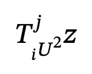

```xml
<math xmlns="http://www.w3.org/1998/Math/MathML"><mmultiscripts><mi>T</mi><mmultiscripts><mi>U</mi><none/><mn>2</mn><mprescripts/><mi>i</mi><none/></mmultiscripts><mi>j</mi></mmultiscripts><mi>z</mi></math>
```

</details>

### P03: Compound root index

**Review:** Can a listener separate the entire index n+1, radicand x and following z? Suggest a complete utterance if additional scope wording is needed.

**English (`en`)**

> the root with index n plus 1 of x end root z

**French (`fr`)**

> racine d'indice n plus 1 de x fin de racine z

**German (`de`)**

> Wurzel mit Wurzelexponent n plus 1 aus x Ende Wurzel z

**Spanish (`es`)**

> raíz de índice n más 1 de x fin de raíz z

**Italian (`it`)**

> radice di indice n più 1 di x fine radice z

<details>
<summary>Reveal intended structure, rendered context and MathML</summary>

Root of x with index n+1, followed by z outside the radical.

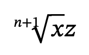

```xml
<math xmlns="http://www.w3.org/1998/Math/MathML"><mroot><mi>x</mi><mrow><mi>n</mi><mo>+</mo><mn>1</mn></mrow></mroot><mi>z</mi></math>
```

</details>

### P04: Nested root in a compound index

**Review:** Are the index, inner radical, outer radicand and final boundary recoverable without the visual?

**English (`en`)**

> the root with index the square root of n plus 1 of a plus b end root z

**French (`fr`)**

> racine d'indice racine carrée de n plus 1 d'a plus b fin de racine z

**German (`de`)**

> Wurzel mit Wurzelexponent Quadratwurzel aus n plus 1 aus a plus b Ende Wurzel z

**Spanish (`es`)**

> raíz de índice raíz cuadrada de n más 1 de a más b fin de raíz z

**Italian (`it`)**

> radice di indice radice quadrata di n più 1 di a più b fine radice z

<details>
<summary>Reveal intended structure, rendered context and MathML</summary>

Root of a+b with index sqrt(n)+1; z follows outside the outer radical.

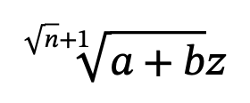

```xml
<math xmlns="http://www.w3.org/1998/Math/MathML"><mroot><mrow><mi>a</mi><mo>+</mo><mi>b</mi></mrow><mrow><msqrt><mi>n</mi></msqrt><mo>+</mo><mn>1</mn></mrow></mroot><mi>z</mi></math>
```

</details>

### P05: Lower bar and upper hat

**Review:** Does the composed lower-then-upper utterance attach both accents to x without suggesting that one decorates the other?

**English (`en`)**

> x underbar hat z

**French (`fr`)**

> x trait souscrit accent circonflexe z

**German (`de`)**

> x Unterstrich Zirkumflex z

**Spanish (`es`)**

> x subbarra circunflejo z

**Italian (`it`)**

> x con barra sotto accento circonflesso z

<details>
<summary>Reveal intended structure, rendered context and MathML</summary>

x has a bar below and a hat above; z follows undecorated. The lower accent is spoken first.

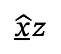

```xml
<math xmlns="http://www.w3.org/1998/Math/MathML"><munderover><mi>x</mi><mo>_</mo><mo>^</mo></munderover><mi>z</mi></math>
```

</details>

### P06: Braces around a compound base

**Review:** Can the listener tell that both braces span a+b, rather than only b or the preceding brace? Review composition, not the sourced brace names alone.

**English (`en`)**

> a plus b bottom brace top brace z

**French (`fr`)**

> a plus b accolade inférieure accolade supérieure z

**German (`de`)**

> a plus b Untere geschweifte Klammer Obere geschweifte Klammer z

**Spanish (`es`)**

> a más b corchete rizado inferior corchete rizado superior z

**Italian (`it`)**

> a più b parentesi graffa inferiore parentesi graffa superiore z

<details>
<summary>Reveal intended structure, rendered context and MathML</summary>

The whole a+b expression has a brace below and a brace above; z is outside both.

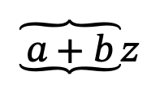

```xml
<math xmlns="http://www.w3.org/1998/Math/MathML"><munderover><mrow><mi>a</mi><mo>+</mo><mi>b</mi></mrow><mo>⏟</mo><mo>⏞</mo></munderover><mi>z</mi></math>
```

</details>

### P07: Lower dot and upper vector

**Review:** Does the complete before/after composition preserve both accent positions on x and keep z outside?

**English (`en`)**

> x under dot vector z

**French (`fr`)**

> vecteur x avec en dessous point z

**German (`de`)**

> Vektor x darunter Punkt z

**Spanish (`es`)**

> vector x y debajo punto z

**Italian (`it`)**

> vettore x con sotto punto z

<details>
<summary>Reveal intended structure, rendered context and MathML</summary>

x has a dot below and a vector arrow above; z is undecorated. The lower dot uses an explicit below description and some languages place the vector noun before the base.

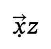

```xml
<math xmlns="http://www.w3.org/1998/Math/MathML"><munderover><mi>x</mi><mo>˙</mo><mo>→</mo></munderover><mi>z</mi></math>
```

</details>


## French formula joining

<a id="french"></a>

### F01: Square root of letter a

**Review:** When naming this mathematical letter in your region, is the complete joining natural? Give the preferred spoken letter name and de/d’ wording.

**French (`fr`)**

> racine carrée d'a

<details>
<summary>Reveal intended structure, rendered context and MathML</summary>

A square root with a single letter variable a, not an ordinary word. The current joining decision uses the written first character.

```xml
<math xmlns="http://www.w3.org/1998/Math/MathML"><msqrt><mi>a</mi></msqrt></math>
```

</details>

### F02: Square root of letter e

**Review:** When naming this mathematical letter in your region, is the complete joining natural? Give the preferred spoken letter name and de/d’ wording.

**French (`fr`)**

> racine carrée d'e

<details>
<summary>Reveal intended structure, rendered context and MathML</summary>

A square root with a single letter variable e, not an ordinary word. The current joining decision uses the written first character.

```xml
<math xmlns="http://www.w3.org/1998/Math/MathML"><msqrt><mi>e</mi></msqrt></math>
```

</details>

### F03: Square root of letter i

**Review:** When naming this mathematical letter in your region, is the complete joining natural? Give the preferred spoken letter name and de/d’ wording.

**French (`fr`)**

> racine carrée d'i

<details>
<summary>Reveal intended structure, rendered context and MathML</summary>

A square root with a single letter variable i, not an ordinary word. The current joining decision uses the written first character.

```xml
<math xmlns="http://www.w3.org/1998/Math/MathML"><msqrt><mi>i</mi></msqrt></math>
```

</details>

### F04: Square root of letter o

**Review:** When naming this mathematical letter in your region, is the complete joining natural? Give the preferred spoken letter name and de/d’ wording.

**French (`fr`)**

> racine carrée d'o

<details>
<summary>Reveal intended structure, rendered context and MathML</summary>

A square root with a single letter variable o, not an ordinary word. The current joining decision uses the written first character.

```xml
<math xmlns="http://www.w3.org/1998/Math/MathML"><msqrt><mi>o</mi></msqrt></math>
```

</details>

### F05: Square root of letter u

**Review:** When naming this mathematical letter in your region, is the complete joining natural? Give the preferred spoken letter name and de/d’ wording.

**French (`fr`)**

> racine carrée d'u

<details>
<summary>Reveal intended structure, rendered context and MathML</summary>

A square root with a single letter variable u, not an ordinary word. The current joining decision uses the written first character.

```xml
<math xmlns="http://www.w3.org/1998/Math/MathML"><msqrt><mi>u</mi></msqrt></math>
```

</details>

### F06: Square root of letter f

**Review:** When naming this mathematical letter in your region, is the complete joining natural? Give the preferred spoken letter name and de/d’ wording.

**French (`fr`)**

> racine carrée de f

<details>
<summary>Reveal intended structure, rendered context and MathML</summary>

A square root with a single letter variable f, not an ordinary word. The current joining decision uses the written first character.

```xml
<math xmlns="http://www.w3.org/1998/Math/MathML"><msqrt><mi>f</mi></msqrt></math>
```

</details>

### F07: Square root of letter h

**Review:** When naming this mathematical letter in your region, is the complete joining natural? Give the preferred spoken letter name and de/d’ wording.

**French (`fr`)**

> racine carrée de h

<details>
<summary>Reveal intended structure, rendered context and MathML</summary>

A square root with a single letter variable h, not an ordinary word. The current joining decision uses the written first character.

```xml
<math xmlns="http://www.w3.org/1998/Math/MathML"><msqrt><mi>h</mi></msqrt></math>
```

</details>

### F08: Square root of letter x

**Review:** When naming this mathematical letter in your region, is the complete joining natural? Give the preferred spoken letter name and de/d’ wording.

**French (`fr`)**

> racine carrée de x

<details>
<summary>Reveal intended structure, rendered context and MathML</summary>

A square root with a single letter variable x, not an ordinary word. The current joining decision uses the written first character.

```xml
<math xmlns="http://www.w3.org/1998/Math/MathML"><msqrt><mi>x</mi></msqrt></math>
```

</details>

### F09: Square root of letter y

**Review:** When naming this mathematical letter in your region, is the complete joining natural? Give the preferred spoken letter name and de/d’ wording.

**French (`fr`)**

> racine carrée de y

<details>
<summary>Reveal intended structure, rendered context and MathML</summary>

A square root with a single letter variable y, not an ordinary word. The current joining decision uses the written first character.

```xml
<math xmlns="http://www.w3.org/1998/Math/MathML"><msqrt><mi>y</mi></msqrt></math>
```

</details>

### F10: Square root of letter É

**Review:** When naming this mathematical letter in your region, is the complete joining natural? Give the preferred spoken letter name and de/d’ wording.

**French (`fr`)**

> racine carrée d'É

<details>
<summary>Reveal intended structure, rendered context and MathML</summary>

A square root with a single letter variable É, not an ordinary word. The current joining decision uses the written first character.

```xml
<math xmlns="http://www.w3.org/1998/Math/MathML"><msqrt><mi>É</mi></msqrt></math>
```

</details>

### F11: Author text homme

**Review:** Is this reading appropriate for the intended pronunciation? State whether explicit author pronunciation or a different joining policy is needed.

**French (`fr`)**

> racine carrée de homme

<details>
<summary>Reveal intended structure, rendered context and MathML</summary>

The radicand is literal author text “homme”. It is not translated; written h or a vowel does not establish how arbitrary author text is pronounced.

```xml
<math xmlns="http://www.w3.org/1998/Math/MathML"><msqrt><mtext>homme</mtext></msqrt></math>
```

</details>

### F12: Author text haricot

**Review:** Is this reading appropriate for the intended pronunciation? State whether explicit author pronunciation or a different joining policy is needed.

**French (`fr`)**

> racine carrée de haricot

<details>
<summary>Reveal intended structure, rendered context and MathML</summary>

The radicand is literal author text “haricot”. It is not translated; written h or a vowel does not establish how arbitrary author text is pronounced.

```xml
<math xmlns="http://www.w3.org/1998/Math/MathML"><msqrt><mtext>haricot</mtext></msqrt></math>
```

</details>

### F13: Author text energy

**Review:** Is this reading appropriate for the intended pronunciation? State whether explicit author pronunciation or a different joining policy is needed.

**French (`fr`)**

> racine carrée d'energy

<details>
<summary>Reveal intended structure, rendered context and MathML</summary>

The radicand is literal author text “energy”. It is not translated; written h or a vowel does not establish how arbitrary author text is pronounced.

```xml
<math xmlns="http://www.w3.org/1998/Math/MathML"><msqrt><mtext>energy</mtext></msqrt></math>
```

</details>

### F14: Disjunctive-word controls

**Review:** Check that a proposed formula-joining policy preserves the normal-word exceptions; do not treat these controls as novel vocabulary needing retranslation.

**French (`fr`)**

> racine carrée de oui ; racine carrée de onze ; racine carrée de onzième

<details>
<summary>Reveal intended structure, rendered context and MathML</summary>

Three square roots with author words oui, onze and onzième, separated by literal semicolons. These are sourced ordinary-word exceptions, included only as joining controls.

```xml
<math xmlns="http://www.w3.org/1998/Math/MathML"><msqrt><mtext>oui</mtext></msqrt><mo>;</mo><msqrt><mtext>onze</mtext></msqrt><mo>;</mo><msqrt><mtext>onzième</mtext></msqrt></math>
```

</details>

### F15: Limit beginning with a vowel-letter expression

**Review:** Is the complete from/to utterance natural for letter names, and can listeners recover the compound lower bound?

**French (`fr`)**

> l'intégrale d'a plus 1 à b

<details>
<summary>Reveal intended structure, rendered context and MathML</summary>

An integral whose lower bound is a+1 and upper bound b. The joining applies to the first spoken token of the complete lower bound.

```xml
<math xmlns="http://www.w3.org/1998/Math/MathML"><msubsup><mo>∫</mo><mrow><mi>a</mi><mo>+</mo><mn>1</mn></mrow><mi>b</mi></msubsup></math>
```

</details>

### F16: Compound root and capitalized author text

**Review:** Assess joining in both complete utterances while retaining the sourced ordinal-root wording. Does the policy need to distinguish letter variables from author text?

**French (`fr`)**

> racine quatrième d'e plus 1 fin de racine ; racine carrée d'Alpha

<details>
<summary>Reveal intended structure, rendered context and MathML</summary>

A fourth root of e+1 followed by a square root of literal author text Alpha. Capitalization and formula composition do not establish pronunciation metadata.

```xml
<math xmlns="http://www.w3.org/1998/Math/MathML"><mroot><mrow><mi>e</mi><mo>+</mo><mn>1</mn></mrow><mn>4</mn></mroot><mo>;</mo><msqrt><mtext>Alpha</mtext></msqrt></math>
```

</details>
