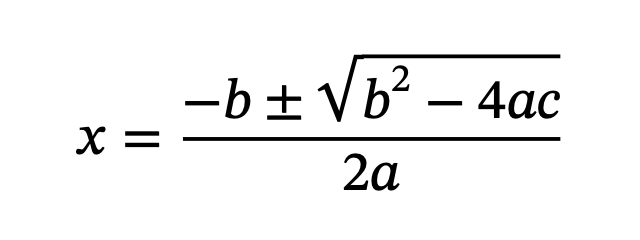
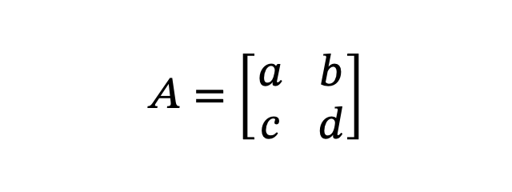
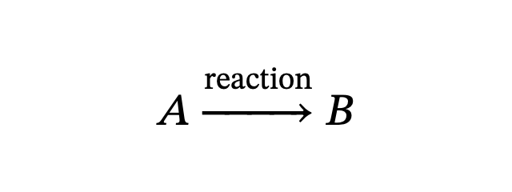

# MathMLLayout

MathMLLayout typesets and draws presentation MathML in native iOS, iPadOS and macOS apps.
It uses CoreText and the system's STIX Two Math font, and draws into any `CGContext`.
Layouts are immutable and thread-safe, so you can prepare formulas off the main thread.

Requires iOS/iPadOS or macOS 27+, Swift 6.2 and Xcode 27.

## Features

- Native drawing with CoreText and CoreGraphics.
- Fractions, radicals, scripts, stretchy operators, tables and elementary math.
- Automatic line breaking and individual rows for inline placement.
- Host-supplied images for `mglyph`.
- Spoken readings in English, French, German, Spanish and Italian.
- Immutable layouts and bounded parsing of untrusted MathML.

## Quick start

Parse a formula, create a layout, then draw it into a context whose y axis points up:

```swift
import CoreGraphics
import Foundation
import MathMLLayout

// `context` is the CGContext supplied by your drawing code.
let markup = #"<math display="block"><mfrac><mi>a</mi><msup><mi>b</mi><mn>2</mn></msup></mfrac></math>"#
let formula = try MathMLNode.parse(xml: Data(markup.utf8))
let layout = try MathLayout(formula, style: MathStyle(
    fontSize: 17, color: CGColor(gray: 0, alpha: 1), isDisplay: true))
layout.draw(in: context, baselineOrigin: CGPoint(x: 0, y: layout.descent))
```

See the [usage guide](doc/usage.md) and [complete drawing example](doc/examples/Drawing.swift)
for layout bounds, parsing and spoken readings.

## Rendering examples

Rendered by MathMLLayout on macOS 27 with STIX Two Math at 28 points.
The PNGs use a white background and 2× resolution.

<table>
<tr><th align="left">MathML</th><th align="center">macOS rendering</th></tr>
<tr>
<td><strong>Fractions, radicals and scripts</strong><pre><code>&lt;math display="block"&gt;
  &lt;mi&gt;x&lt;/mi&gt;&lt;mo&gt;=&lt;/mo&gt;
  &lt;mfrac&gt;
    &lt;mrow&gt;
      &lt;mo&gt;−&lt;/mo&gt;&lt;mi&gt;b&lt;/mi&gt;&lt;mo&gt;±&lt;/mo&gt;
      &lt;msqrt&gt;
        &lt;msup&gt;&lt;mi&gt;b&lt;/mi&gt;&lt;mn&gt;2&lt;/mn&gt;&lt;/msup&gt;
        &lt;mo&gt;−&lt;/mo&gt;&lt;mn&gt;4&lt;/mn&gt;&lt;mi&gt;a&lt;/mi&gt;&lt;mi&gt;c&lt;/mi&gt;
      &lt;/msqrt&gt;
    &lt;/mrow&gt;
    &lt;mrow&gt;&lt;mn&gt;2&lt;/mn&gt;&lt;mi&gt;a&lt;/mi&gt;&lt;/mrow&gt;
  &lt;/mfrac&gt;
&lt;/math&gt;</code></pre></td>
<td align="center"></td>
</tr>
<tr>
<td><strong>Tables and stretchy fences</strong><pre><code>&lt;math display="block"&gt;
  &lt;mi&gt;A&lt;/mi&gt;&lt;mo&gt;=&lt;/mo&gt;
  &lt;mfenced open="[" close="]"&gt;
    &lt;mtable&gt;
      &lt;mtr&gt;
        &lt;mtd&gt;&lt;mi&gt;a&lt;/mi&gt;&lt;/mtd&gt;&lt;mtd&gt;&lt;mi&gt;b&lt;/mi&gt;&lt;/mtd&gt;
      &lt;/mtr&gt;
      &lt;mtr&gt;
        &lt;mtd&gt;&lt;mi&gt;c&lt;/mi&gt;&lt;/mtd&gt;&lt;mtd&gt;&lt;mi&gt;d&lt;/mi&gt;&lt;/mtd&gt;
      &lt;/mtr&gt;
    &lt;/mtable&gt;
  &lt;/mfenced&gt;
&lt;/math&gt;</code></pre></td>
<td align="center"></td>
</tr>
<tr>
<td><strong>Annotated stretchy operators</strong><pre><code>&lt;math display="block"&gt;
  &lt;mi&gt;A&lt;/mi&gt;
  &lt;mover&gt;
    &lt;mo&gt;→&lt;/mo&gt;
    &lt;mtext&gt;reaction&lt;/mtext&gt;
  &lt;/mover&gt;
  &lt;mi&gt;B&lt;/mi&gt;
&lt;/math&gt;</code></pre></td>
<td align="center"></td>
</tr>
</table>

The [MathML files](doc/examples/mathml) and [macOS renderer](doc/examples/RenderGallery.swift)
are included; see [how to regenerate the images](doc/usage.md#regenerating-the-readme-gallery).

## Documentation

- [Usage](doc/usage.md): parsing, layout and drawing.
- [Line breaking](doc/line-breaking.md): wrapping formulas and placing rows.
- [Images](doc/images.md): supplying images for `mglyph`.
- [Spoken readings](doc/speech.md): accessibility and language selection.
- [Speech wording audit](Documentation/SpeechWordingAudit.md): source evidence and remaining questions from #31.
- [Supported markup](doc/markup.md): elements, attributes and layout rules.
- [Fonts](doc/fonts.md): font selection and fallbacks.
- [Bounds and limitations](doc/limits.md): input limits and unsupported behavior.
- [Testing](doc/testing.md): debug, release, simulator and fuzz testing.
- [Notices](doc/notices.md): speech attribution, specification and font acknowledgments.
- [Swift examples](doc/examples): source code linked from the guides.
- [Changelog](CHANGELOG.md): release history.

## License

MathMLLayout's original code is available under the [MIT license](LICENSE).
Selected speech material retains MathCAT's MIT and Speech Rule Engine's Apache-2.0
requirements; see [third-party notices and redistribution instructions](THIRD_PARTY_NOTICES.md).
